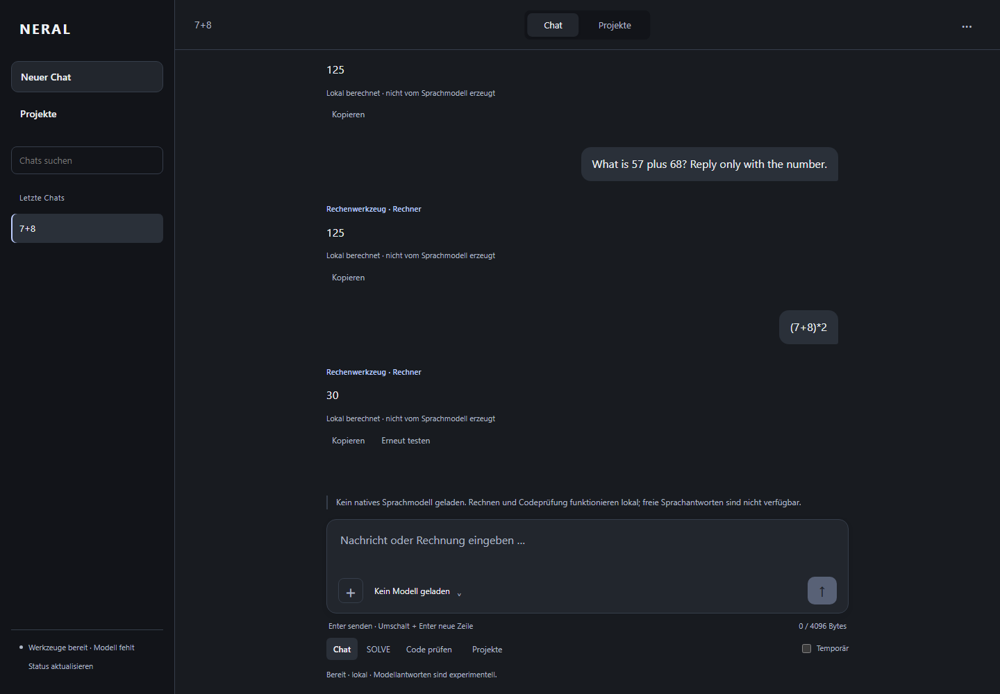
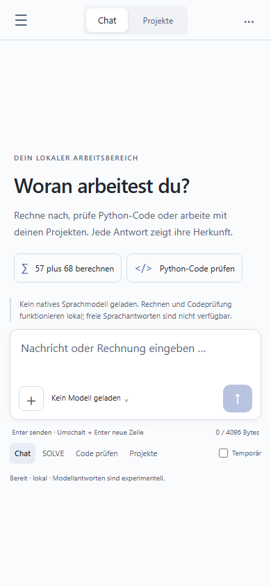
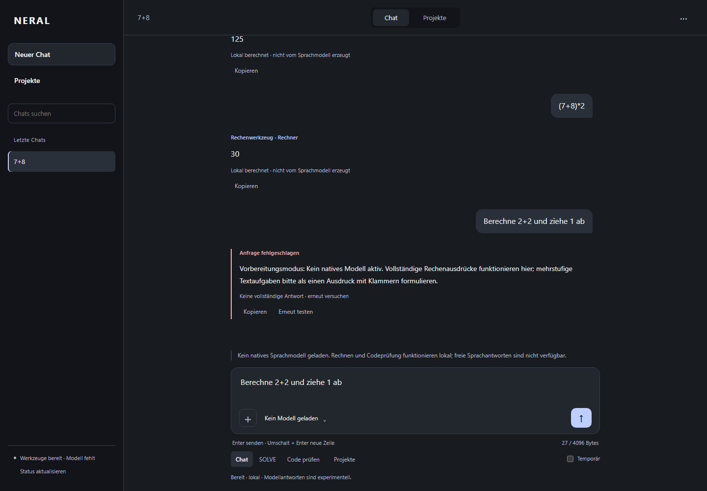

# NERAL Chat Experience & Stability

## Audit und Branch-Basis

Arbeitsbasis ist `main` auf `4e4dca3da0d8bc0d3ee5ec697edb7575cf9aa278`.
Der eigene Branch heißt `codex/neral-chat-experience-stability`.

| Oberfläche / Funktion | Stand am Ausgangspunkt |
| --- | --- |
| `START_NERAL.bat` → `launcher.py` → `app.py`, Port 9680 | Tatsächlicher Flask-Einstieg; Vanilla JS/CSS, eigene Byte-Modelle 20M/40M/50M. |
| Streaming, ChatStore/SQLite, Projekte, PWA, Einstellungen, Entwürfe | Bereits auf main integriert; in diesem Update erhalten und regressionsgeprüft. |
| `Start-Neral.ps1` | Zusätzlicher Paketstarter; weder neu geplant noch als Hintergrundjob installiert. |
| PR #167, Head `c9be40a` | Draft gegen `experiment/arctus350-separated-arithmetic-specialist-20261028`; Rechner-/Compound-Fixes nur im experimentellen `frontier350/chat350_tools.py`. |
| PR #172, Head `ea850cb` | Draft **auf #167**, DE/EN-Instruktionssuffixe; nicht direkt auf main. |
| `frontier350/chat_web350.py` auf dem Experiment-Stack | Separater Gradio-/Arctus350-Einstieg; nicht Teil des main-Flask-Runtimes. Kein 350M-Lader wird in diesem Update vorgetäuscht. |
| Externe Modelle | Keine externe Inferenz im Flask-Chat. Explizit externe importierte Antworten sind nur Gesprächsdaten, kein Modellanbieter. |

Es wurde kein Experiment-Branch zusammengeführt oder vollständig kopiert.
`chat_math.py` portiert die benötigten begrenzten AST-/Fraction-Operationen,
komplette Ausdruckserkennung, Prozentrechnung und DE/EN-Suffixe gezielt aus
#167/#172. Die lockeren Wortproblem-/Sequenz-/Kraft-Handler werden nicht übernommen.
Ein zusätzlich gefundener Fehler bei mehrzeiligen Anfragen ist behoben: Der
Parser muss die gesamte Anfrage inklusive weiterer Zeilen berücksichtigen.
Zahlenliterale werden aus den Originalziffern gelesen, ohne Float-Zwischenrundung.

## Tatsächliche Änderungen

- `/api/generate` nutzt den Rechner im **normalen Chatmodus** vor der nativen
  Runtime-Prüfung. Das funktioniert auch ohne Modell. Sicherheitsprüfung und
  HTTP-/Sitzungs-/Größenlimits bleiben vorgeschaltet.
- Quellen werden im JSON und an den Nachrichten getrennt: `tool:calculator`,
  `tool:percentage`, `tool:solve`, `tool:code-check`, `local-rule:security`,
  `native-model`. Native Antworten nennen `model_family: neral-byte`; Info nennt
  ausdrücklich `external_inference: false` und `native_arctus350_integrated: false`.
  Das bestehende `solve.result` bleibt für bisherige API-Clients verfügbar.
- Keine Teilergebnisse als erledigte mehrstufige Aufgabe: `(7+8)*2` wird vollständig
  gerechnet. `Berechne 2+2 und ziehe 1 ab` fällt durch. Ohne Modell erscheint ein
  klarer Fehlerhinweis; mit installiertem eigenen Modell kann der vorhandene
  experimentelle Sprachpfad antworten, dessen Korrektheit hier nicht behauptet wird.
- Neue ruhige, responsive Produktansicht auf bestehendem HTML/CSS. Keine entfernten
  Fonts, Bildgeneratoren, Dekorationsfunktionen oder zusätzlichen Laufzeitbibliotheken.
  Beispiele füllen echte Eingaben; bestehende Projekte und Einstellungen bleiben erreichbar.
- Eingabe wächst bis zu einer Obergrenze; Bytebudget und Tastaturhinweise sind sichtbar.
  Enter sendet, Umschalt+Enter fügt eine Zeile ein; Code behält mehrzeiliges Enter.
  Während einer Antwort kann ein neuer Entwurf geschrieben werden. Senden/Stoppen
  und Verbindungs-/Ladezustände folgen dem tatsächlichen Zustand.
- Fehler lassen die Frage im Gespräch stehen und stellen einen leeren Eingabeentwurf
  wieder her. Bereits neu geschriebene Entwürfe werden nicht überschrieben.
  Abgebrochene Antworten tragen ein Unvollständigkeitsmerkmal und gelangen nicht
  erneut in den Modellkontext. Neue Varianten erhalten den ursprünglichen Chat.
- Stream-Abschlüsse ohne abschließenden Zeilenumbruch funktionieren. Fehlende oder
  doppelte Abschlüsse, widersprüchliche Quellen, ungültiges JSON und zu große Streams
  werden zurückgewiesen. Fehlermeldungen zeigen keine Parser-Rohdaten.
- Laufende Nachrichten überleben ein erneutes Rendern, etwa beim Chatabgleich.
  Beim Lesen älterer Nachrichten bleibt die Scrollposition erhalten; ein funktionierender
  Sprung zur neuesten Nachricht ist verfügbar. Importierte externe Texte bleiben
  explizit extern, werden weiterhin nur als Text/erlaubtes Markdown gerendert und
  verlassen nie über den nativen Kontext die Herkunftsgrenze.

## Lokal starten – ohne Modellgewichte und ohne GPU

Python 3.12, vorhandener Browser. Windows/PowerShell:

```powershell
python -m venv .venv
.\.venv\Scripts\python.exe -m pip install -r requirements.txt
.\.venv\Scripts\python.exe -m pip install torch==2.8.0 --index-url https://download.pytorch.org/whl/cpu
$env:HELIOS_DEVICE = 'cpu'
$env:HELIOS_PREPARATION_MODE = '1'
.\.venv\Scripts\python.exe app.py
```

Danach [lokale App öffnen](http://127.0.0.1:9680). `HELIOS_PREPARATION_MODE=1`
sperrt das Laden von Modellen ausdrücklich. Rechner, Codeprüfung und Projekte
bleiben aktiv. Alternativ startet `START_NERAL.bat` denselben Flask-Einstieg.
Es werden keine Checkpoints, Cloud-Schlüssel oder fremden Modelle nachgeladen.
Bestehende lokale Zustandsdateien werden außerhalb der Tests unter `local_state/`
verwendet; Tests setzen separate leere Assets- und Zustandsordner.

Das Paket enthält keine neu integrierte native Arctus350-Inferenz. Deren separates
Tokenizer-/Checkpoint-/GPU-Protokoll wird durch die Byte-App nicht ersetzt.

## Reproduzierbare Prüfungen

```powershell
.\.venv\Scripts\python.exe -m pytest -q tests/test_helios_runtime.py tests/test_helios_chat_experience.py tests/test_projects.py tests/test_helios_i1_ready.py tests/test_helios_install.py tests/test_helios_workspace.py
node --test tests/test_helios_history.js
# Vorhandenes Browser-Testwerkzeug, keine App-Laufzeitabhängigkeit:
npm install --no-save playwright
npx playwright install chromium
$env:HELIOS_TEST_PYTHON = (Resolve-Path .venv/Scripts/python.exe).Path
node tests/test_helios_browser.cjs
node tests/test_helios_workspace.cjs
node tests/test_helios_chat_experience.cjs
```

Der letzte Browser-Test startet **app.py** mit eigenem zufälligem Port, leeren
Modellpfaden, separatem ChatStore, CPU und Vorbereitungsmodus. Keine API-Mocks
für Rechenergebnisse. Geprüft werden 7+8=15, DE/EN 57+68=125, `(7+8)*2=30`,
Verweigerung einer unvollständig unterstützten Aufgabe, Fehler-/Entwurfserhalt,
Neuladen, externe Importkennzeichnung, XSS, Tastatur, 360/390/768/1440 Pixel Breite
und eine kurze Mobilansicht mit 390×480 Pixeln. Zwei weitere vorhandene Browserläufe
prüfen UI-Funktionen sowie Streaming/Synchronisierung mit **expliziten Test-APIs**;
deren Modelltexte sind keine echten Modellmessungen.

Ein vorhandener Edge kann mit `HELIOS_TEST_BROWSER` als ausführbarem Pfad verwendet
werden. Jeder Browserlauf verwendet ein separates Headless-Profil, keine persönlichen
Browsersitzungen. Auf eingeschränkten Windows-Systemen können lokale Socket-/Browser-
Tests zusätzliche Ausführungsrechte benötigen. Der Workflow `Helios app CPU tests`
führt diese Prüfungen auf Linux und die vorhandenen Startertests auf Windows aus.

## Messwerte, Screenshots und Grenzen

Ausgeführte RED-/GREEN-Läufe und genaue Ergebnisse stehen unter
[`evidence/chat_experience_20261028/`](../evidence/chat_experience_20261028/README.md).
Der erste echte Browser-RED-Lauf scheiterte an der gesperrten Werkzeug-Chat-Eingabe.
Es gibt keine Behauptung, die Sprachmodellgewichte oder deren Intelligenz seien verbessert.
Nativer Durchsatz, Modellantwortqualität, echter Modellstopp und reale Geräte-Touch-
Tastaturen wurden ohne kompatible Gewichte/Hardware nicht gemessen.

Desktop, echter Flask-Einstieg, ausschließlich Rechenwerkzeuge:



Mobil, echter Flask-Einstieg, heller Modus:



Verständlicher Fehler statt irreführendem Teilergebnis:


